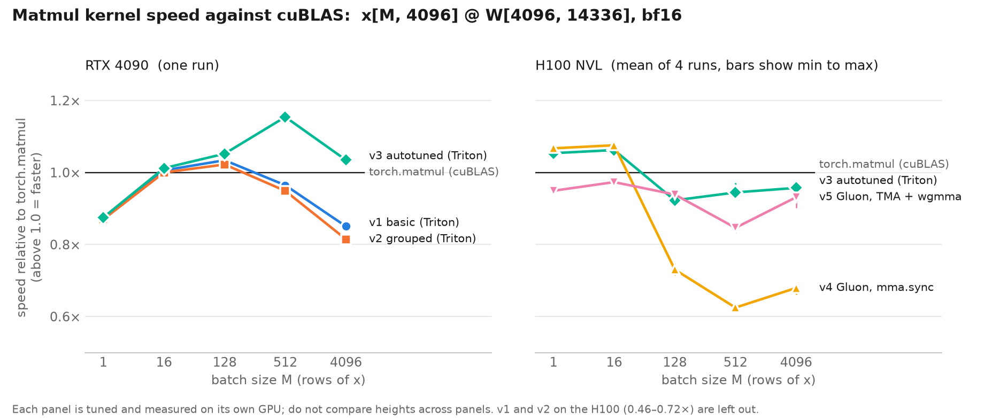

# llama-matmul-kernels

A GPU kernel for the largest matrix multiply in Llama-3.1-8B's MLP block, written three times in Triton and twice in Gluon, and measured against `torch.matmul` (cuBLAS) on an RTX 4090 and an H100.

```
out = x @ W_gate      x: [M, 4096]   W_gate: [4096, 14336]   bf16 in and out, fp32 accumulation
```

M is the batch size. The project measures M = 1, 16, 128, 512 and 4096, because small M is limited by memory bandwidth and large M by arithmetic, and a kernel that is good at one is not automatically good at the other.



## Results

Speed relative to `torch.matmul` on the same GPU. Above 1.00x means faster than cuBLAS.

**RTX 4090** (one benchmark run; run-to-run variation is about 1-3%)

| M | v1 basic | v2 grouped | v3 autotuned |
|---|---|---|---|
| 1 | 0.87x | 0.87x | 0.88x |
| 16 | 1.01x | 1.00x | 1.01x |
| 128 | 1.03x | 1.02x | 1.05x |
| 512 | 0.96x | 0.95x | **1.15x** |
| 4096 | 0.85x | 0.81x | 1.03x |

**H100 NVL** (range over four benchmark runs)

| M | v3 autotuned (Triton) | v4 Gluon, mma.sync | v5 Gluon, TMA + wgmma |
|---|---|---|---|
| 1 | 1.05-1.06x | **1.06-1.08x** | 0.94-0.95x |
| 16 | 1.06-1.07x | **1.07-1.08x** | 0.97-0.98x |
| 128 | 0.92-0.93x | 0.71-0.75x | 0.93-0.94x |
| 512 | 0.93-0.97x | 0.62-0.63x | 0.83-0.86x |
| 4096 | 0.91-0.97x | 0.66-0.69x | 0.90-0.95x |

Each GPU was tuned and measured separately, so the two tables are not comparable with each other.

What the numbers say:

- On the 4090, the autotuned Triton kernel matches or beats cuBLAS at four of five sizes and is 12% slower at M = 1.
- On the H100, the hand-written Gluon kernel is 6-8% faster than cuBLAS at M = 1 and 16. At M = 128 and above, cuBLAS is ahead of every version.
- Switching the Gluon kernel from `cp.async` + `mma.sync` to TMA + wgmma makes it 1.29-1.38x faster at M >= 128.
- The Gluon kernels match Triton's compiler at some sizes and trail it at others. They do not beat it.

Full tables, roofline numbers, tuned configs and a paragraph on each version are in [RESULTS.md](RESULTS.md).

## The five versions

| File | What it is | What it showed |
|---|---|---|
| `v1_basic.py` | Triton. Fixed 64x64x32 tiles, one program per tile. | Already level with cuBLAS at memory-bound sizes on the 4090. |
| `v2_grouped.py` | v1 plus grouped tile ordering for L2 cache reuse. | No gain. v1's 2D grid was already running tiles in a cache-friendly order. |
| `v3_autotuned.py` | v2 plus `@triton.autotune` over 138 configs per size. | 22-27% faster than v2 at large M on the 4090. Bigger tiles do more arithmetic per byte loaded. |
| `v4_gluon.py` | The same kernel in Gluon: layouts, shared memory and the load pipeline written by hand, using `cp.async` and `mma.sync`. | Equals v3 wherever Triton also uses `mma.sync`. Falls behind where Triton switches to wgmma. |
| `v5_gluon_hopper.py` | Gluon with the H100-only features: TMA loads, one mbarrier per buffer, wgmma. | Recovers most of the gap to v3 at large M. Worse at tiny M, because wgmma's smallest tile is 64 rows. |

## How it was measured

- **Roofline first.** `roofline.py` computes the best possible time per size from the GPU's peak bandwidth and peak bf16 throughput, and says whether each size is memory-bound or compute-bound.
- **Correctness.** `test_matmul.py` compares every kernel with `torch.matmul` at every size. The tolerance allows two bf16 rounding steps, because the two sides add 4096 products in different orders.
- **Timing.** `bench.py` uses `triton.testing.do_bench`, which warms up, flushes the L2 cache before each run and times with CUDA events. Medians are reported.
- **What actually ran.** `dump_ir.py` saves the compiler's intermediate code and the PTX. The instruction counts in RESULTS.md come from those files.

## Run it

Needs an NVIDIA GPU. Versions are pinned to torch 2.14.1 (CUDA 13.2 build) and triton 3.8.0; the Gluon API changes between Triton versions.

```
pip install -r requirements.txt --extra-index-url https://download.pytorch.org/whl/cu132
python gpu_specs.py         # detected GPU and the spec row in use
python roofline.py          # results/roofline_<gpu>.csv
python v3_autotuned.py      # tune v3
python v4_gluon.py          # smoke test, then tune v4
python v5_gluon_hopper.py   # H100/H200 only
pytest -v test_matmul.py
python bench.py             # results/bench_<gpu>.csv
python dump_ir.py           # ir/<gpu>/
python plot.py              # results/speed_vs_torch.png, no GPU needed
```

A GPU that is not in `gpu_specs.py` raises an error instead of using a near-miss row. Add a row for it first.

## Limits

- This is one matmul, not the fused MLP `silu(x @ W_gate) * (x @ W_up)`.
- No profiler was run. Explanations of why a version is faster come from timings and from reading the generated PTX.
- The peak bf16 figures for the RTX cards are estimates, and the H100 NVL figures were written from memory and not re-checked, so "% of roofline" is approximate. "vs torch" does not depend on them.
- Not done: persistent kernels, warp specialization, split-K, and finding why v5 trails v3 at M = 512 on the H100.
- All timings are from rented machines, one of each GPU.
